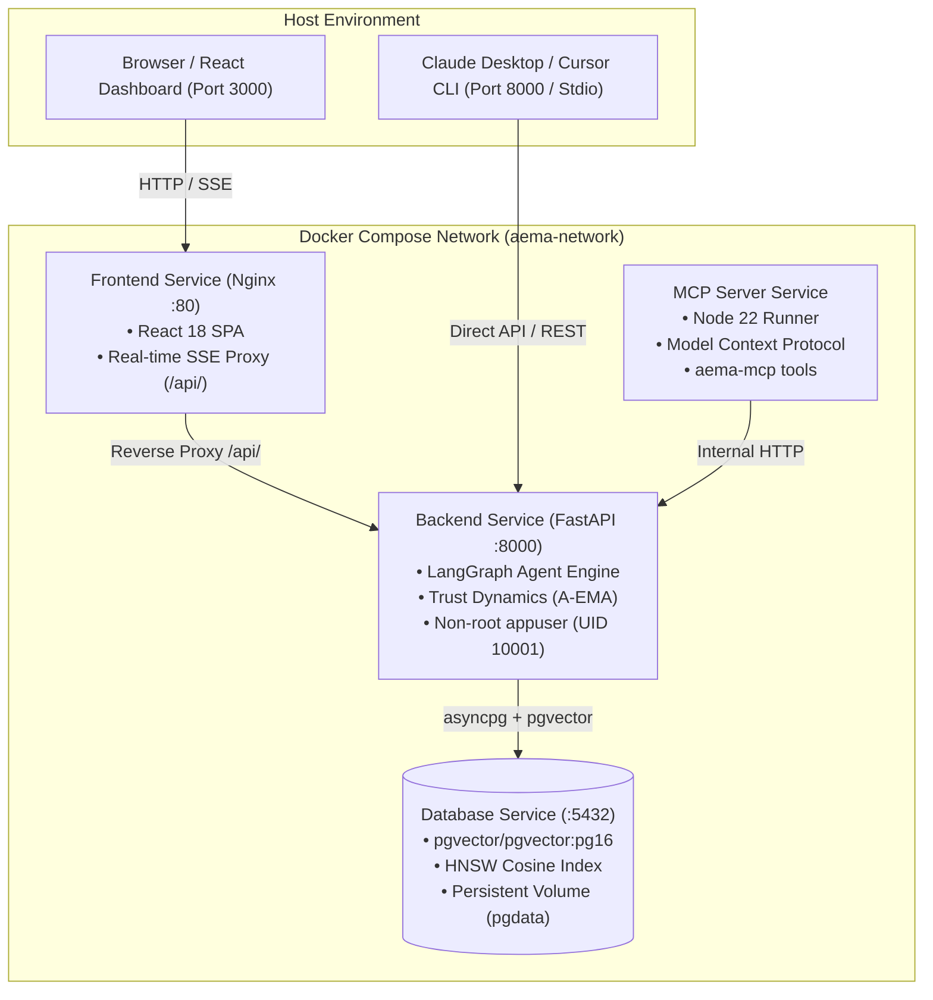

# AEMA Docker & Multi-Container Deployment Guide

This handbook details production deployment strategies for **AEMA (Adaptive Experience Memory Agent)** using Docker and Docker Compose.

---

## 1. Architecture Topology



---

## 2. Quickstart Paths

### Path A: Solo Developer / Student (Zero-Config Single Container)
Run the memory backend in standalone SQLite mode with persistent data on your host machine:

```bash
# 1. Build the local image
docker build -t aema-server:latest .

# 2. Run the container
docker run -d \
  --name aema-server \
  -p 8000:8000 \
  -v aema_data:/data \
  aema-server:latest
```

* Verify health:
  ```bash
  curl -s http://localhost:8000/api/v1/health | jq .
  # Expected: {"status":"ok","service":"adaptive-agent-backend"}
  ```

---

### Path B: Production Multi-Container (PostgreSQL 16 + pgvector)
Run the complete multi-service stack with one command:

```bash
# 1. Clone repository
git clone https://github.com/Sumit-ai-dev/Adaptive-Agent-Memory-OJT-G146.git
cd Adaptive-Agent-Memory-OJT-G146

# 2. Launch complete cluster
docker compose up -d
```

* Check service health:
  ```bash
  docker compose ps
  ```

* Expected output:
  | Service | State | Ports | Health |
  | :--- | :--- | :--- | :--- |
  | `aema-db` | Up | `0.0.0.0:5432->5432/tcp` | healthy |
  | `aema-backend` | Up | `0.0.0.0:8000->8000/tcp` | healthy |
  | `aema-frontend` | Up | `0.0.0.0:3000->80/tcp` | healthy |
  | `aema-mcp` | Up | - | running |

* Access UI: Open [http://localhost:3000](http://localhost:3000) in your browser.
* Access API Docs: Open [http://localhost:8000/api/docs](http://localhost:8000/api/docs).

---

## 3. Configuration Reference

All environment variables can be set in a local `.env` file or passed directly in `docker-compose.yml`:

| Variable | Default | Description |
| :--- | :--- | :--- |
| `STORAGE_ENGINE` | `postgres` | Persistence engine (`postgres` or `sqlite`) |
| `DATABASE_URL` | `postgresql://aema:aema_password@db:5432/aema_db` | Connection string for PostgreSQL + pgvector |
| `AEMA_DB_PATH` | `/data/adaptive_memory.db` | Fallback SQLite file path |
| `POSTGRES_DB` | `aema_db` | Postgres database name |
| `POSTGRES_USER` | `aema` | Postgres database user |
| `POSTGRES_PASSWORD` | `aema_password` | Postgres database password |
| `ADMIN_API_KEY` | `dev-admin-key` | Secret key for administrative telemetry & purge endpoints |
| `GROQ_API_KEY` | - | Optional LLM provider key for Groq |
| `OPENAI_API_KEY` | - | Optional LLM provider key for OpenAI |
| `GEMINI_API_KEY` | - | Optional LLM provider key for Google Gemini |

---

## 4. End-to-End Verification

### 1. Store a Verified Experience
```bash
curl -X POST http://localhost:8000/api/v1/memories \
  -H "Content-Type: application/json" \
  -d '{
    "task_domain": "coding",
    "trigger_condition": "FastAPI async database deadlock under load",
    "strategy_lesson": "Use asyncpg connection pooling with pool.acquire context managers",
    "pitfall": "Opening raw unpooled connections inside individual route endpoints",
    "confidence": 0.95
  }'
```

### 2. Semantic Search with Cosine Similarity (<=>)
```bash
curl -X POST http://localhost:8000/api/v1/memories/search \
  -H "Content-Type: application/json" \
  -d '{
    "query": "How to handle database connections in FastAPI?",
    "task_domain": "coding",
    "limit": 3
  }' | jq .
```

---

## 5. Connecting External Agents

### Claude Desktop Configuration
Add the following to your `claude_desktop_config.json`:

```json
{
  "mcpServers": {
    "aema": {
      "command": "docker",
      "args": [
        "run",
        "-i",
        "--rm",
        "--network", "aema-network",
        "-e", "AEMA_API_URL=http://backend:8000",
        "aema/mcp:0.1.1"
      ]
    }
  }
}
```

### Cursor IDE Configuration
Configure under `.cursor/mcp.json`:

```json
{
  "mcpServers": {
    "aema": {
      "command": "npx",
      "args": ["-y", "--package=@sumitaidev/aema", "aema-mcp"],
      "env": {
        "AEMA_API_URL": "http://localhost:8000"
      }
    }
  }
}
```

---

## 6. Multi-Architecture Builds (amd64 / arm64)

To build images supporting both Apple Silicon (M1/M2/M3/M4) and Intel/AMD cloud servers:

```bash
# Enable Docker Buildx
docker buildx create --use --name aema-builder

# Build and export backend
docker buildx build \
  --platform linux/amd64,linux/arm64 \
  -t ghcr.io/sumit-ai-dev/aema:0.1.1 \
  -f Dockerfile \
  .
```
